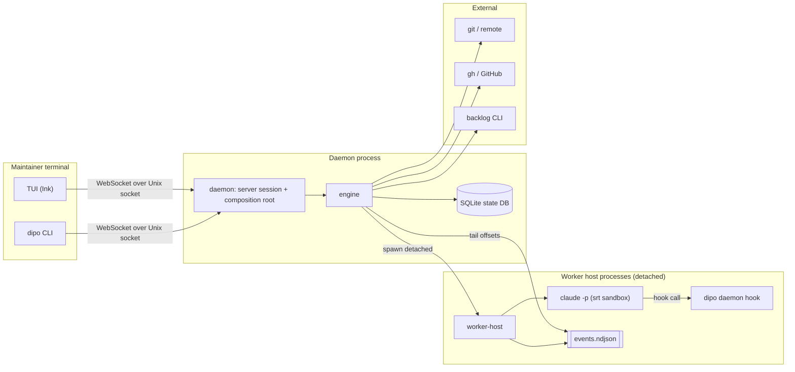
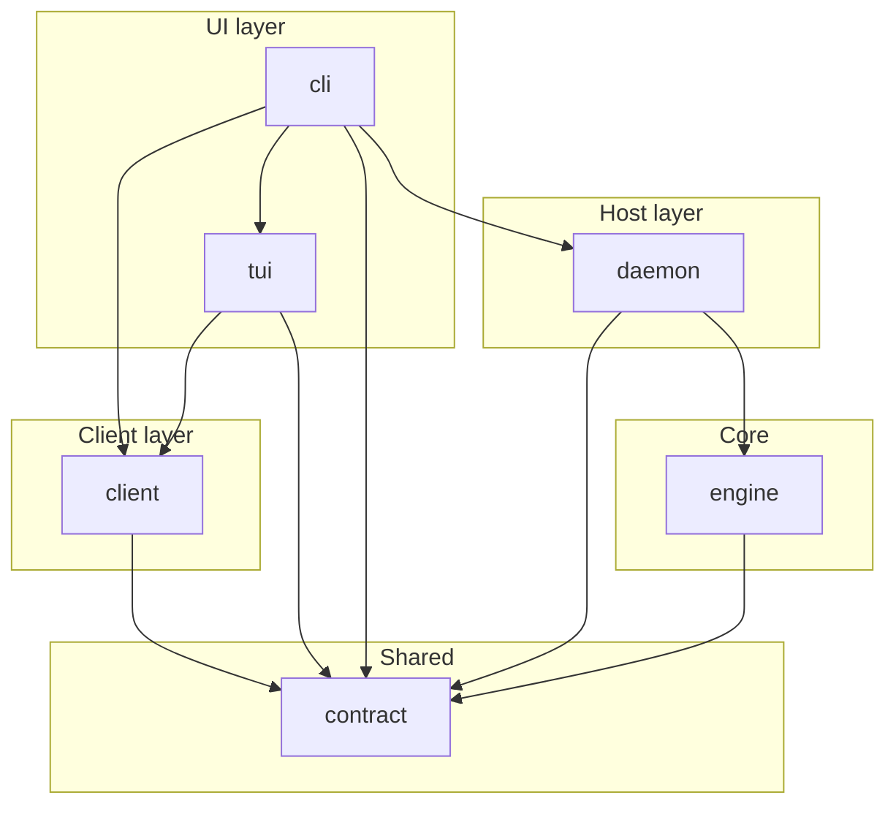
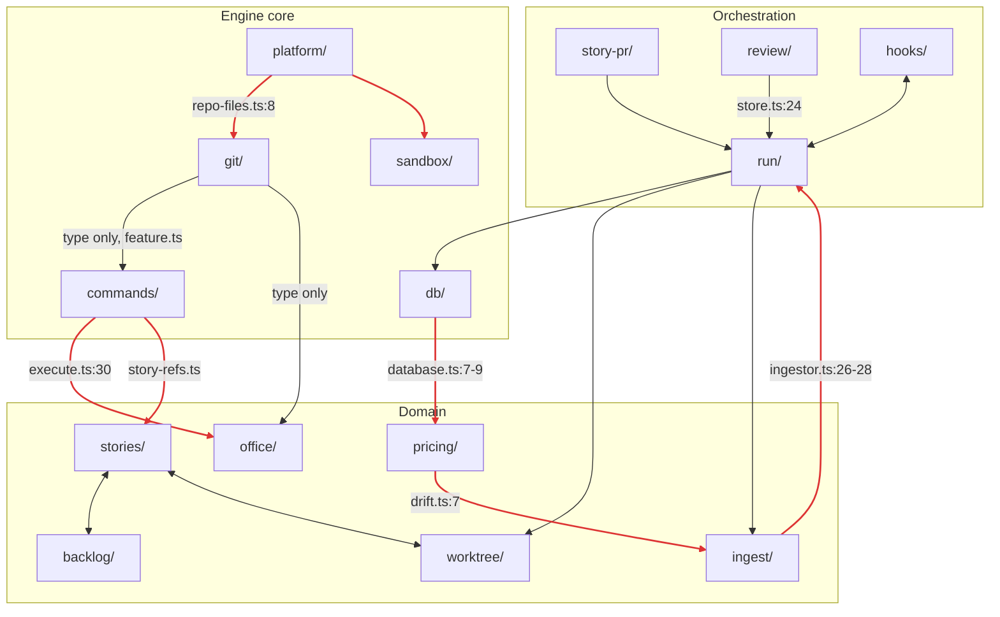
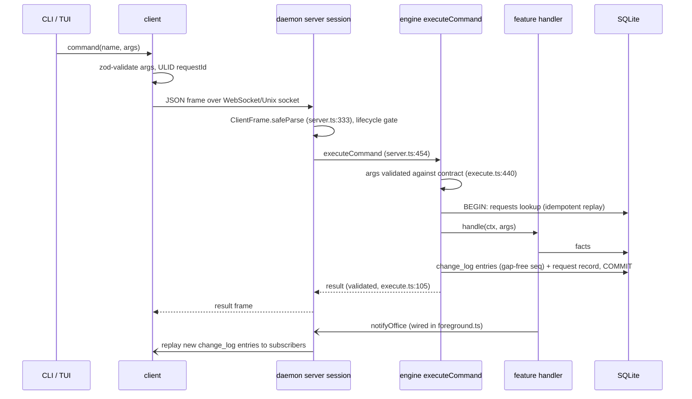
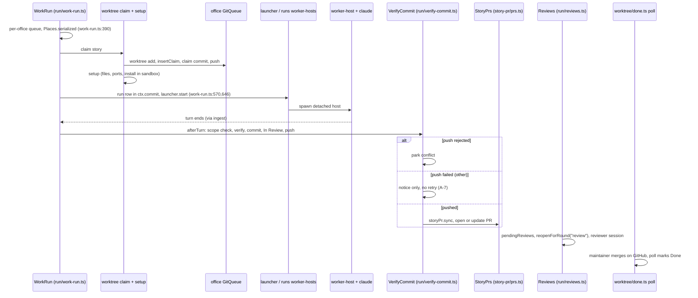
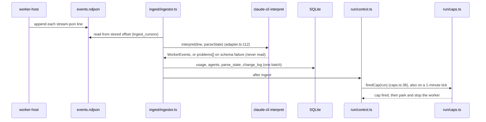
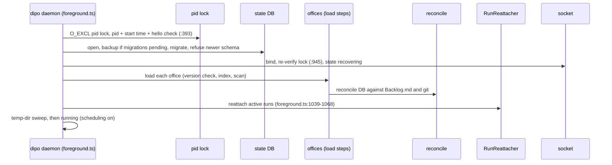
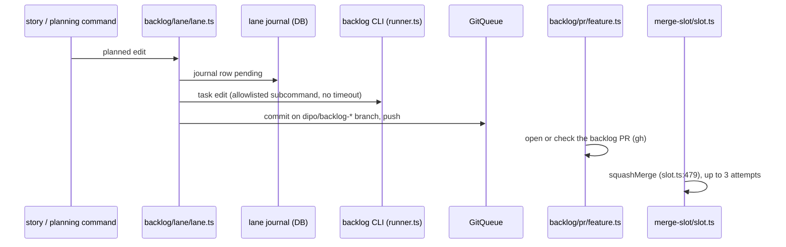

# Architecture Review — dipsaus-orchestrator (whole repository) — 2026-10-21

Status: historical review. The current status of every finding is in `milestone-review-2026-11-02.md` (section A.0, the earlier-findings table).

## 1. Executive summary

`dipo` is a local daemon and CLI/TUI that delivers Backlog.md stories unattended. It runs each story in a git worktree with a sandboxed Claude Code worker, enforces budgets, verifies the result, opens a PR and has it reviewed. It is a TypeScript/Bun modular monolith of about 97k lines, 76% of them in `engine`.

**Overall health:** the package boundaries, data layer, contract and build are strong. Inside the engine, though, structure has not kept pace with growth, and the error paths around external tools and the worker stream are the weakest part of a product that promises to run unattended.

Top issues, in priority order:
1. **A-1:** Backlog CLI and gh subprocesses have no timeout, on office-serial paths. One hang freezes an office without anything reporting it.
2. **A-4:** budget enforcement silently fails open when the Claude stream's usage shape drifts. Parse problems are recorded and never read.
3. **A-3:** engine sub-directories have no layering. 28 of 33 sit in one import cycle, `db`, `platform` and `git` included.
4. **A-2:** the run lifecycle has no explicit state machine. Transitions are decided in about 10 files, and key tables have several writers.
5. **A-5:** the engine's composition root is a 795-line, order-dependent function in the daemon, and the engine barrel exposes about 756 names, the raw DB among them.

**The single most valuable change** is to give every external subprocess a deadline and kill (A-1, effort S). It turns the most likely overnight failure, a silent stall, into a coded error that the existing park and notice machinery already knows how to handle.

## 2. System overview

**Purpose.** `dipo` is a local, single-user orchestrator. It reads a repository's Backlog.md board, picks stories that pass a deterministic Ready gate, and gives each one a git worktree. It then runs a Claude Code CLI worker on the story inside a sandbox, caps its tokens, turns, and time, verifies and commits the result, and pushes the branch. Finally it opens a story PR and runs a separate reviewer session. The maintainer watches and steers through a terminal UI or the CLI. Whatever code can know (selection, gates, git, budgets, status) is decided in code. The model writes code and reviews.

**Runtime contexts** (all on the maintainer's machine, except CI):

| Context | What runs | Failure mode that matters |
|---|---|---|
| Interactive terminal | `dipo` CLI commands and the Ink TUI (`packages/cli`, `packages/tui`, `packages/client`) | Daemon unreachable or a different build |
| Daemon (long-lived, launchd/systemd) | `dipo daemon` = `packages/daemon` hosting `packages/engine`; one SQLite database for all offices | Crash mid-run, hung subprocess, restart, upgrade |
| Worker host (detached, one per agent) | `dipo daemon worker-host` spawning `claude -p` in the srt sandbox, appending `events.ndjson` | Worker hang, crash, output-format drift, budget overrun |
| Short-lived helpers | `dipo daemon hook` (Claude hook), `daemon sandbox-exec`, Safe-Chain gate | Timeout, fail-open versus fail-closed |
| CI | GitHub Actions: `verify`, smoke on four targets, release (dry run) | Platform gaps (macOS) |

**Stack.** TypeScript 7 on Bun 1.4.2, compiled into one binary (`scripts/build.ts`). Zod 4 contract. SQLite through `bun:sqlite`, with 40 forward-only migrations. WebSocket over a Unix socket for IPC. Ink 8 and React 19 for the TUI. `@anthropic-ai/sandbox-runtime` (srt) for sandboxing. External tools are spawned: `git`, `gh`, `backlog` (Backlog.md CLI 1.53.x), `claude`. oxlint and oxfmt, `bun test`, release-please.

**Shape.** A modular monolith in a Bun workspace: 7 packages and about 97k non-test source lines. The engine has 74k of those lines in 364 files and 33 sub-directories. There are 377 test files with about 3,200 tests. The engine is everything inside the daemon; the other packages are thin by comparison.

What to notice: the only path into the engine is the daemon's socket session. Workers never talk to the engine directly: their output reaches the engine only through a file the engine tails, which is why a daemon restart can re-attach to running workers. All four external tools are subprocesses, so their timeouts are this system's availability (see A-1).

## 3. Module map

| Module | Responsibility | Depends on | Used by | Owns state | Notes |
|---|---|---|---|---|---|
| `contract` | Zod schemas for commands, reads, events, envelope, ids, config keys; JSON-schema export | zod | all packages | none | Validated on both ends. One version `{1,1}` with "minor still unreleased" (`version.ts:12-64`) |
| `client` | Socket transport, reconnect and resend, `OfficeStore` projection, daemon lifecycle (start, stop, supervisor units) | contract, zod | cli, tui | none (reads runtime/lock files) | Re-implements engine platform rules (A-11) |
| `tui` | Ink overview, queue, detail, settings | client, contract | cli | none | `App` is a god component (`app.tsx:227-840`) |
| `cli` | `dipo` entry, subcommands, `watch` | client, contract, daemon, tui | binary | none | `watch` folds events itself (A-12) |
| `daemon` | Process host: lock, lifecycle, socket session, composition root, helper entry points | engine, contract | cli | pid lock, runtime record | `serve()` is about 795 lines of wiring (A-5) |
| `engine/db`, `platform` | DB open and migrate, `OfficeHandle`; sqlite, process, paths, lock, serve, gh host, sandbox, safe-chain | contract | everything | all 54 tables (schema) | `platform` is a catch-all and imports up (A-3) |
| `engine/commands`, `reads`, `changelog`, `views` | Registry, executors with idempotency, change-log outbox, view derivation | db, office, stories, config | daemon, every feature | `requests`, `change_log`, `offices.next_seq` | Good core (section 7) |
| `engine/run`, `runs`, `review`, `story-pr`, `merge-slot`, `gate` | Run lifecycle (pickup, launch, caps, verify, park, resume, reattach, review rounds), worker-host rows, story PRs, backlog-PR merge, Ready gate | db, workers, prompts, git, worktree, backlog, views, ingest | daemon | `runs`, `agents`, `parks`, `run_*`, `verify_results`, `worker_hosts`, … | `run/` is 16k lines with no single job (A-2) |
| `engine/workers`, `host`, `hooks`, `sandbox`, `prompts`, `context`, `pricing`, `ingest` | Worker port and Claude adapter, detached host, hook policy, srt policy, prompt assembly, pricing, event ingest | db, run, platform | run, daemon | `ingest_cursors`, usage rows, `questions`, pricing (append-only) | Real port, with leaks (A-9); parsing drift is invisible (A-4) |
| `engine/backlog`, `git`, `worktree`, `scan`, `stories`, `office`, `reconcile` | Backlog CLI adapter and lane, hardened git queue, claim and setup and teardown, run profile, story index and mirror, office lifecycle, start-up reconcile | db, platform, commands, run | run, daemon | `claims`, `backlog_mirror`, lane journal, `offices` | Backlog only through the CLI; no subprocess timeouts (A-1) |
| `testkit` (private) | ManualClock, ids, temp repos, FakeProcess replay, listener guard | contract | tests only | none | No suite-wide state-dir guard (A-6) |

Package graph (verified from `package.json` files and grep of imports):

What to notice: no package-level violations exist. No UI package imports engine; `cli → daemon` is only `runDaemon` (`cli/src/index.ts:22`). The package boundary is real and enforced by oxlint plus TypeScript project references. The problems are inside `engine`, which this graph hides.

Engine sub-directory graph, reduced to the edges that break layering. The edges were verified with a resolved import graph script over all non-test files; red edges are runtime (value) imports that point "upward":

What to notice: 28 of the 33 engine sub-directories sit in one strongly connected component (19 counting runtime imports only, `db` included). File-level cycles are banned by `import/no-cycle` (`.oxlintrc.json:92`), but no rule stops a low layer (db, platform, git, commands) from importing a high one. Several of the back-edges exist to share one small helper. One example is `utcDay` in `pricing/drift.ts:7`.

## 4. Critical flows

### 4.1 Command from a client (primary write path at the boundary)

- **Trust boundary:** the Unix socket. The only guard is a 0700 runtime directory owned by the uid (`engine/platform/paths.ts:201-219`). The `auth` frame is a no-op (`daemon/src/server.ts:426-428`), and there is no peer-credential check. For a single-user local daemon that is acceptable, provided workers cannot reach the socket. The sandbox's Unix-socket allowlist enforces that (`workers/claude-cli/plan.ts:544-547`).
- Synchronous commands are atomic and idempotent per `requestId` (`commands/execute.ts:126-166`). **Async commands commit several transactions.** Facts written before a throw stay (`execute.ts:179`), so every async handler must be idempotent by hand.
- Live delivery depends on each writer remembering to call `notifyOffice`. The server then replays from the DB (`server.ts:569`), so a missed call delays the update rather than losing it.
- Reads and subscribes on one connection are processed one at a time (`server.ts:280,412,521`). One slow office load therefore stalls the TUI connection (A-10).
- The server logs each frame's `requestId` at debug level (`server.ts:349-354`), but the command and read executors log nothing, neither the outcome nor the failure (A-16).

### 4.2 Running a story (the product's main job)

- **There is no single state machine.** Run state is spread over `ended_at`, `end_kind`, `waiting`, parks, intents and claims. Which transition happens is decided in about 10 files (A-2). The writes use compare-and-set guards (`run/records.ts:413,463`), which keeps them safe. They are still hard to follow.
- The claim crosses three systems (the git worktree, the DB row, the remote push) with no saga record. Two crash windows leave orphans (A-8).
- Error paths diverge. A rejected push parks the story; any other push failure only posts a notice. The story is then In Review locally, still gets reviewed, and never gets a PR (A-7).
- The closing half of the review loop is still planned work. Fix rounds and conflict rounds have kinds (`run/rounds.ts:20-28`), but `reopenForRound` is only called with `"review"` (`run/reviews.ts:236`). Story-PR merging through the merge slot is DIPO-150. DIPO-148, 149, 150 and 157 track all of this.
- Three pollers per office read PR state on `prStateSeconds`: `merge-slot/slot.ts:654`, `story-pr/prs.ts:703` and `worktree/done.ts:270` (A-13).

### 4.3 Worker events to budget enforcement (background processing)

- **The budget is only as good as the parser.** A line that fails its schema is appended to `state.problems` (`interpret.ts:433`), and nothing outside `interpret.ts` reads that field. Unknown message types are dropped. Only a minimum CLI version is enforced (`probe.ts:11`). If a new Claude CLI changes the usage shape, usage reads as zero and the cap never fires (A-4).
- Ingest is offset-based and stores `parse_state` with each batch. That makes it restartable and idempotent, a strong design.
- A cap check after each ingest plus a one-minute tick catches a silent hang. One turn can still overshoot the cap before the check.

### 4.4 Daemon start, reconcile and re-attach (recovery)

- Recovery steps are registered in `serve()` in a fixed order (`foreground.ts:1000-1081`). The order is a hidden contract in the composition root (A-5).
- A crash counter (3 crashes in 10 minutes starts the daemon in `safe`) and exit 78 for supervisors stop restart loops (`foreground.ts:495,1113`).
- Merge-slot occupancy is not rebuilt, because it lives only in memory (`merge-slot/slot.ts:131-147`, A-13).
- Reattach is tested in-process with a FakeProcess (`engine/test/run/reattach.ci.test.ts`). No test kills a real daemon during a live run.

### 4.5 Planning write through the backlog lane

- Backlog.md is touched only through the CLI, with an allowlist and a never-run list (`backlog/runner.ts:56-80`). One `--plain` parser is shared by every reader. This is a clean adapter.
- The lane writes a journal row first (`backlog/lane/journal.ts:10-20`). Until the commit is pushed, that row is the only copy of the change. ADR 0010 section 2 accepts this by design.
- `runBacklog` has no timeout (`runner.ts:295-320`). It runs inside office-serial work, so a hung `backlog` stalls the office (A-1).

## 5. Findings

Each finding was checked by an independent verifier that had not seen this draft. Line numbers are as of commit `992a78f7`. Three draft findings were rejected and dropped. Four were downgraded; they appear here at the lower severity. See the appendix.

### Critical

None. Nothing found causes data loss or a trust-boundary failure under normal operation. The sandbox layer is fail-closed, and the DB layer is careful.

### High

### A-1: Backlog CLI and gh calls have no timeout, and they run on office-serial paths
- Severity: High | Effort: S | Dimension: Error handling & failure modes
- Location: `packages/engine/src/backlog/runner.ts:286-321`; `packages/engine/src/platform/host.ts:718-726` (`#raw`, used by every `#ok` at `:392-596`); `packages/engine/src/platform/process.ts:510`; `packages/engine/src/stories/index-stories.ts:80`; `packages/engine/src/worktree/done.ts:13`
- Evidence:
  - `runBacklog` awaits stdout, stderr and `exited` with no timer and no kill. The gh `#raw` does the same.
  - Only `#tailRun` (`host.ts:635-660`) and git's `execWithTimeout` (`git/runner.ts:96-126`) have deadlines. git applies its deadline only to commit, push and fetch (`:185`).
  - The one caller-side deadline (`commands/execute.ts:391-397`) neither kills the child nor frees the queue.
  - The whole story index pass is one office queue item, and Done polls run one at a time.
- Why it matters here: the product promises unattended runs. One `backlog` that waits on a lock, or one `gh` stalled on the network, freezes that office: claims, lane flushes, teardown and Done detection. Nothing reports it, because nothing has failed.
- Recommendation: give `runBacklog` and `GhHost.#raw` the same `execWithTimeout`-style deadline that git uses (kill the process group, throw a coded `timedOut` error), with a default of 60 s. Then give git a default timeout for all steps, not just three.

### A-2: The run lifecycle has no explicit state machine, and its tables have many writers
- Severity: High | Effort: L | Dimension: Data ownership & state management
- Location: `packages/engine/src/run/` (49 files, 16k lines); `run/records.ts:413,463`; `run/outcome-exits.ts:81-96`; `run/reattach.ts:667-684,874-884`; `run/park.ts:488`; `stories/planning.ts:273`; `reconcile/reconcile.ts:447`
- Evidence:
  - Run state is spread over `runs.ended_at`, `end_kind`, `waiting`, `parks`, `run_intents` and `claims`. The decision about which transition happens is made in about 10 files.
  - The "end the agent, close the ingest cursor, end the worker host" SQL appears three times, in `outcome-exits.ts` and twice in `reattach.ts`.
  - Writes are spread across modules:
    - `parks` is inserted from three directories.
    - `agents` is written by 7 non-test files.
    - `worker_hosts` is written from `runs/`, `run/reattach.ts`, `run/resume.ts`, `run/review-launch.ts` and `ingest/ingestor.ts`.
  - `run/` also re-exports `stories/planning` (`run/index.ts:320`). Its name is one letter away from `runs/`.
- Why it matters here: every M1 story in the backlog (fix rounds, conflict rounds, resume, top-up, discard; DIPO-148 to DIPO-161) adds a transition. With no single place that says "from state X, event Y gives state Z", each story re-derives the rules and can miss a guard. Duplicated end-SQL drifts.
- Recommendation: put the transition rules in one pure function in `run/lifecycle.ts`. The function takes the current state and an event and returns the next state plus the writes to make, and callers execute those writes. Start with the three duplicated "end agent" blocks. Make `parks` and `worker_hosts` each have one writing module that others call.

### A-3: Engine sub-directories are not layered; 28 of 33 form one import cycle
- Severity: High | Effort: M | Dimension: Boundaries & dependency direction
- Location: `.oxlintrc.json:92`; `packages/engine/src/db/database.ts:7-9`; `pricing/drift.ts:7`; `ingest/ingestor.ts:26-28`; `platform/repo-files.ts:8`; `platform/sandbox.ts`, `platform/safe-chain-gate.ts`, `platform/safe-chain-proxy.ts`; `commands/execute.ts:30`; `commands/story-refs.ts:9`
- Evidence:
  - The import graph, resolved by top-level engine sub-directory, has one strongly connected component of 28 directories. Counting only runtime imports it has 19, and `db` is one of them.
  - A concrete runtime chain:
    - `db/database.ts` imports `pricing/import`.
    - `pricing/drift.ts:7` imports `utcDay` from `ingest/usage`.
    - `ingest/ingestor.ts` imports `run/criteria`, `run/signals` and `views/work`.
    - `run` imports `db`.
  - `platform` imports `git` and `sandbox`. `platform/host.ts` (the gh adapter, 727 lines) and `platform/safe-chain-proxy.ts` are domain adapters sitting in `platform`.
  - `import/no-cycle` with `ignoreTypes` catches only file-level cycles.
- Why it matters here: the package boundaries are clean, but 76% of the code sits inside one package with no inner direction. No engine sub-directory can be understood, tested or extracted without the rest. One example is the second worker adapter that ADR 0008 anticipates. Each new feature adds edges at no visible cost.
- Recommendation: declare four layers (core = `platform`, `db`, `log`; infra adapters = `git`, `backlog`, `sandbox`, gh host; domain; orchestration) and add a `dipo/engine-layers` rule to the existing custom oxlint plugin (`tools/lint/oxlint-plugin.js`). Break the five runtime back-edges first:
  - Move `utcDay` into `platform`.
  - Have `db` receive the pricing import as a load step.
  - Move `git/hardened` args into `platform`, or move `repo-files` into `git`.
  - Move `host.ts` and `safe-chain-*` out of `platform`.
  - Invert `ingest → run` through a callback port.

### A-4: The budget fails open when the Claude stream format drifts
- Severity: High | Effort: S | Dimension: Error handling & failure modes
- Location: `packages/engine/src/workers/claude-cli/interpret.ts:433` (callers `:523,551,557,1217`); `workers/claude-cli/adapter.ts:111`; `workers/claude-cli/schema.ts:57-59`; `workers/claude-cli/probe.ts:11`; `run/caps.ts:38`; `tools/recordings/status.ts:1-4`
- Evidence:
  - A line that fails its schema is appended to `state.problems`, and no code outside `interpret.ts` reads `problems`.
  - Usage fields are required in the schema, so a renamed or reshaped usage field makes the whole message drop. Unknown message types are dropped silently.
  - `probe.ts` enforces only a minimum CLI version.
  - Recordings freshness is a manual `recordings:status` that no CI job runs.
  - The pre-launch self-test refuses a run whose *result* line cannot be parsed (`self-test.ts:656`), so gross drift fails closed. Usage drift does not.
- Why it matters here: "Budgets are enforced" is one of the five differentiators in `docs/vision.md`. Claude Code updates often. A usage-shape change makes `firedCap` see zero tokens, and an unattended overnight run spends until the turn cap or the time cap fires.
- Recommendation: treat a non-empty `problems` (or N dropped lines per run) as a park cause, `worker.streamDrift`, in the ingestor. Record the highest recorded CLI version and post a notice when the probe sees a newer one. Make the self-test assert that usage was non-zero.

### A-5: The engine's composition root is a 795-line function in the daemon, and the engine's public surface leaks the DB
- Severity: High | Effort: M | Dimension: Coupling & cohesion
- Location: `packages/daemon/src/foreground.ts:424-1219`; `foreground.ts:646,708,786,862`; `packages/engine/src/run/compose.ts:427-450`; `packages/daemon/src/runs.ts:296`; `packages/engine/src/index.ts:11-16,144`; `foreground.ts:485`
- Evidence:
  - `serve()` wires about 30 engine services through late-binding closures. The registry is used at `:646`, `:708` and `:786` before it is defined at `:862`.
  - Feature registration order sets the load-step order, and recovery-step order is fixed in the same function.
  - `composeRuns` uses a mutable `late` object, but `VerifyCommit`, `StoryPrs`, `MergeSlot` and `WorkRun` are built in the daemon instead.
  - The engine barrel has 124 export statements and about 756 names, including `SqliteConnection`, `OfficeHandle` and `appendEntries`. The daemon consumes 181 symbols and touches `database.connection` directly.
- Why it matters here: every new engine service means editing the daemon's god function in the right spot. The engine can't be started headless in an integration test without copying that wiring. A wrong registration order is a silent bug at start-up. This is the "engine is headless" rule kept by convention, not by structure.
- Recommendation: add `createEngine(deps): Engine` in the engine. It owns the wiring, load-step order and recovery-step order, and exposes `executeCommand`, `executeRead`, `subscribe`, `recover`, `drain`. The daemon then only provides the process concerns: lock, socket, signals, clock. Shrink the barrel to that surface. DIPO-127 (function-length caps) would then pass for `serve()`.

### Medium

### A-6: Tests have no suite-wide state isolation
- Severity: Medium (downgraded from High) | Effort: S | Dimension: Testing architecture
- Location: `packages/engine/src/platform/paths.ts:60-66`; `bunfig.toml:3-6`; `packages/testkit/src/env.ts`, `testkit/src/runtime.ts:67-81`; `packages/daemon/test/unit/runtime-isolation.test.ts:227`
- Evidence: the state directory falls back to the real user directory when no env is injected. The bunfig preload only checks listeners. Isolation comes from opt-in helpers (`daemonTestEnv`, `isolatedDaemonEnv`), and a test checks that daemon-starting tests use them. Engine-level tests that resolve paths on their own are not covered.
- Why it matters here: a new test that forgets the helper reads or writes the maintainer's live `dipo` state, including the socket and the DB, while a real daemon may be running.
- Recommendation: in the existing preload, set `DIPO_HOME` (and the runtime directory) to a fresh directory under `DIPO_TMP` before any test runs. Make `paths.ts` refuse the real home when `NODE_ENV=test` or `DIPO_TEST=1` is set.

### A-7: A push that fails without a rejection is never retried, yet the story is still reviewed
- Severity: Medium | Effort: S | Dimension: Async, concurrency & background work
- Location: `packages/engine/src/run/verify-commit.ts:706-778`; `packages/engine/src/story-pr/records.ts:169`; `packages/engine/src/run/review-rounds.ts:143-160`
- Evidence:
  - A non-rejection push error records a notice ("…on this machine only until a later push succeeds"). No code ever pushes again: only `claim.ts:555` and `verify-commit` push story branches.
  - The PR poll needs `pushed_at >= ended_at`, so no PR ever opens.
  - `pendingReviews` does not check `pushed_at`, so a reviewer still runs on the unpushed code.
- Why it matters here: one network blip at the end of an overnight run leaves a story In Review that no PR, CI or maintainer will ever see. A reviewer budget is spent on it too.
- Recommendation: have the existing story-PR poll also push claims where `pushed_at is null` and the run ended at In Review. Gate `pendingReviews` on `pushed_at`.

### A-8: Two crash windows in the claim leave orphans that only a human can clear
- Severity: Medium | Effort: M | Dimension: Async, concurrency & background work
- Location: `packages/engine/src/worktree/claim.ts:263-268` vs `:389`; `claim.ts:463-467`; `claim.ts:664-689`; `packages/engine/src/worktree/feature.ts:126-143`; `packages/engine/src/reconcile/git-facts.ts:1-6`
- Evidence:
  - If the daemon dies between `git worktree add` and `insertClaim`, a worktree with no record is left. The next pickup skips the story on `pathExists`.
  - If it dies between the claim commit and `updateClaim(claimSha)`, `rollBackInterruptedSetup` leaves that commit out of `made`, so the branch is not reset. The next claim then collides.
  - Reconcile reports gone worktrees and never prunes.
- Why it matters here: a crash, upgrade restart or power loss during pickup silently takes a story out of rotation.
- Recommendation: write an intent row (`claim_intents`: story, path, branch) before `worktree add`. Have recovery finish or undo each step it names, which includes resetting a branch that has the claim commit at its tip.

### A-9: Claude specifics leak outside the worker adapter
- Severity: Medium | Effort: M | Dimension: Boundaries & dependency direction
- Location: `packages/daemon/src/hook.ts:15-19,42-45,209`; `packages/engine/src/run/launch.ts:77-80`; `packages/engine/src/hooks/web-guard.ts:60-61`; `packages/engine/src/config/schema.ts:642-684`
- Evidence: the daemon's hook entry imports `encodeClaudeOp` and `claudeGateOutput` and reads the Claude payload field `tool_input.command`. Claude tool names appear in `run/` and `hooks/`. Model aliases (`haiku`, `sonnet`, `opus`) are hard-coded in the office config schema.
- Why it matters here: CLAUDE.md and ADR 0008 make the adapter the only place Claude is known. Each leak is a place a second adapter, or a Claude CLI rename, has to touch outside `workers/claude-cli/`.
- Recommendation: add to `WorkerPort` a `hookCodec` (decode payload, encode decision) and a `toolNames` map, and have the daemon hook call the port. Move the model aliases into an adapter-provided enum that config validates against.

### A-10: The IPC session processes reads one at a time on each connection, with no server-side deadline
- Severity: Medium | Effort: M | Dimension: API contracts
- Location: `packages/daemon/src/server.ts:279-283,412,445,521`; `packages/engine/src/reads/execute.ts:140`; `packages/engine/src/platform/serve.ts:96-102`
- Evidence:
  - Reads and subscribes are awaited in sequence on each connection. A read with `waits`, or subscribe's `offices.load`, blocks every later frame on that connection.
  - Commands run concurrently with no limit.
  - No request has a server-side timeout.
  - Live software events have no high-water mark and rely on the hard 8 MiB terminate. A replay error closes the connection on purpose to force a resubscribe.
- Why it matters here: the TUI keeps one connection open. One slow office load (made worse by A-1) freezes the whole overview, keystroke-driven reads included.
- Recommendation: dispatch reads concurrently, keyed by `requestId` as commands already are. Order only subscribes to the same stream. Add a per-read deadline that returns a coded `timedOut`.

### A-11: Engine platform rules are re-implemented in the client
- Severity: Medium | Effort: M | Dimension: Coupling & cohesion
- Location: `packages/client/src/node/lifecycle/process.ts:1-7`, `files.ts`, `runtime.ts`, `logs/reader.ts`; `test/lifecycle-parity/lifecycle-parity.test.ts`
- Evidence: process identity, lock and runtime-record parsing, the state-directory rule and log-rotation names exist twice. The repetition is deliberate (documented at `process.ts:1-7`) and kept honest only by a parity test.
- Why it matters here: every change to the runtime layout is a two-place edit. The parity test only covers the cases someone thought to add.
- Recommendation: move these pure rules into `contract`, or into a new runtime-free `@dipsaus-orchestrator/runtime-layout` package that both engine and client import. Then delete the parity test.

### A-12: The CLI `watch` command derives its own state instead of using the client store
- Severity: Medium | Effort: S | Dimension: Coupling & cohesion
- Location: `packages/cli/src/watch-command.ts:300-503` (event fold, switch at `:310`), `:46-55`, `:74`, `:80`; `packages/tui/src/format.ts:67`, `tui/src/views.tsx:20`, `tui/src/output.ts:14-39`; `storyRef` in `cli/src/run-command.ts:253`, `stop-command.ts:20`, `story-commands.ts:61`, `intervene-commands.ts:19`, `gate-command.ts:21`; `tui/src/app.tsx:585,622` vs `cli/src/stop-command.ts:58`
- Evidence:
  - `watch` folds events with its own handlers and does not use `OfficeStore`.
  - These exist twice, between the CLI and the TUI:
    - The percent formatting, in slightly different forms.
    - The health labels.
    - The `OutputRange` encoder and decoder.
  - `storyRef` is copied four times.
  - The TUI hard-codes which actions confirm, while the CLI reads `definition.confirm`.
- Why it matters here: every new event or health value must be added in two folds and two label maps. The confirmation rule can already differ between clients for the same command, which defeats the contract's `confirm` flag.
- Recommendation: build `watch` on `OfficeStore`. Move the shared formatters into a small module in `client`. Have the TUI read `definition.confirm`.

### A-13: Merge-slot state lives only in memory, and three pollers read the same PR state
- Severity: Medium | Effort: S | Dimension: Data ownership & state management
- Location: `packages/engine/src/merge-slot/slot.ts:131-151,654`; `packages/engine/src/story-pr/prs.ts:703`; `packages/engine/src/worktree/done.ts:270`
- Evidence: the `parked` and `noticed` maps are never persisted, and `slot.ts` writes nothing to the DB. Three pollers per office read PR state on `prStateSeconds`.
- Why it matters here: after a restart a parked PR re-enters the slot, and a checks-stuck PR can hold the lane for another wait period. `--match-head-commit` keeps merges themselves safe. DIPO-150 will route *story* PRs through this slot, which multiplies the effect.
- Recommendation: persist slot occupancy and parked PRs in a small table before DIPO-150 lands. Have one PR-state poller per office publish to the three consumers.

### A-14: Long work holds office-serial paths
- Severity: Medium | Effort: M | Dimension: Performance architecture
- Location: `packages/engine/src/run/work-run.ts:391,467,472`; `packages/engine/src/run/launch.ts:4-6`; `packages/engine/src/stories/read.ts:176-189`; `packages/engine/src/stories/index-stories.ts:80`; `packages/engine/src/stories/branch-read.ts:78`
- Evidence:
  - The serialized pickup step covers the claim, `launcher.prepare` (setup and dependency install) and `launcher.start`.
  - The index pass is one queue item. It makes 2 list calls plus N `readStory` CLI calls with no cache, and one `cpSync` of `backlog/` for each claimed story.
- Why it matters here: a slow `bun install` delays every reviewer start and every other pickup in the office. With M2's parallel runs, index-pass cost grows with the size of the backlog.
- Recommendation: release the serialization once the claim row is committed, so setup and install run outside it. Cache `readStory` by file mtime or blob sha within a pass.

### A-15: The test suite never runs on macOS in CI
- Severity: Medium | Effort: S | Dimension: Build, CI & deployment
- Location: `.github/workflows/ci.yml:16-45`; `.github/actions/smoke`
- Evidence: `verify`, with `DIPO_TEST_CI=1`, runs only on `ubuntu-24.04`. The macOS lanes run build and smoke, which includes a real deny-all `sandbox-exec` probe, but not the test suite. Local runs on macOS skip `*.ci.test.ts`.
- Why it matters here: the maintainer's daemon runs on macOS under launchd with the seatbelt sandbox, and the 53 CI-only tests never run there.
- Recommendation: add a `verify-macos` job on `macos-15` running `bun test` with `DIPO_TEST_CI=1`, and include it in `ci-ok`.

### Low

### A-16: Command and read executors log nothing
- Severity: Low (downgraded from Medium) | Effort: S | Dimension: Observability
- Location: `packages/engine/src/commands/execute.ts`; `packages/engine/src/reads/execute.ts`; `packages/daemon/src/server.ts:349-354`
- Evidence: the server logs each frame's `requestId` at debug level, but the executors write no outcome, duration or error line. 18 engine files use the logger.
- Why it matters here: an "it failed overnight" question has to be answered from the change log, not from logs.
- Recommendation: one structured log line per command and read at the executor: name, `requestId`, office, outcome code, ms.

### A-17: The protocol minor version does not move before release
- Severity: Low (downgraded from Medium) | Effort: S | Dimension: API contracts
- Location: `packages/engine/src/reads/hello.ts:84-86`; `packages/contract/src/version.ts:12-64`
- Evidence: hello compares only the major. Minor 1 has taken in about 25 changes. `engineVersion`, `buildCommit` and `engineBehind` let builds be told apart.
- Why it matters here: it is only a hazard once separate client and daemon builds exist after v0.1.0.
- Recommendation: bump the minor with each contract change from v0.1.0 on, and have the client refuse a daemon with a lower minor when it needs the newer definitions.

### A-18: `daemon.stop {stopWorkers: true}` is accepted but never stops workers
- Severity: Low (downgraded from Medium) | Effort: S | Dimension: API contracts
- Location: `packages/daemon/src/control.ts:90-100`; `packages/daemon/src/foreground.ts:1147-1154`; `packages/daemon/src/drain.ts:41,79-82`; `packages/client/src/node/lifecycle/lifecycle.ts:480`
- Evidence: `drain()` gets no `stopWorkers` callback and logs "no workers to stop". No in-tree caller sends `true` today.
- Why it matters here: the contract advertises a behaviour the daemon doesn't have. The first client that uses it will be misled, and the log will say so wrongly.
- Recommendation: wire `stopWorkers` to the run controller's stop-all, or remove the flag from the contract until it is wired.

### A-19: gh-command detection is written three times, and the Bash hook fails open on timeout
- Severity: Low | Effort: S | Dimension: Coupling & cohesion
- Location: `packages/engine/src/hooks/gh-guard.ts`; `packages/daemon/src/hook.ts:168-180`; `packages/engine/src/workers/claude-cli/hooks.ts:7,140-146`; `packages/engine/src/hooks/temp-guard.ts`
- Evidence: there are three gh detectors. The hook timeout letting the call through is a documented residual risk; the sandbox is the hard layer. `temp-guard.ts` (779 lines) is really the shared Bash lexer.
- Why it matters here: parser fixes (DIPO-261, DIPO-262) must land in three places.
- Recommendation: rename the lexer to `hooks/bash-lexer.ts` and have the daemon's `namesGh` and the guard both call one `namesGh` there.

### A-20: Test fakes ship in production source
- Severity: Low | Effort: S | Dimension: Testing architecture
- Location: `packages/engine/src/workers/scripted.ts`; `packages/engine/src/index.ts:571-577`; `packages/cli/src/fake-workspace.ts`; `packages/tui/src/testing/`; `packages/contract/src/fixtures.ts`
- Evidence: `ScriptedWorker` is exported from the engine entry and has no production caller.
- Why it matters here: it enlarges the binary and the public surface, and invites production use of a fake.
- Recommendation: move these into `testkit`, or into `test/` folders.

### A-21: The TUI ignores `NO_COLOR` in direct colour sites, and `App` is a god component
- Severity: Low | Effort: M | Dimension: Frontend architecture
- Location: `packages/tui/src/views.tsx:80` (only `Colored` checks); `settings.tsx:86`, `queue.tsx:128,173`, `views.tsx:100,149,233`, `overview.tsx:461`, `detail.tsx:564`; `app.tsx:227-840,466-676`
- Evidence: chalk only honours the `--no-color` argv flag, not the `NO_COLOR` env. `App` holds 15 `useState`s and a key handler of about 210 lines.
- Why it matters here: `NO_COLOR` users still get colour. Every new mode makes the key handler longer.
- Recommendation: route all colour through `Colored`, or a theme hook. Split `App` per mode, with a mode reducer.

### A-22: The CLI statically imports the TUI and the daemon
- Severity: Low | Effort: S | Dimension: Performance architecture
- Location: `packages/cli/src/index.ts:22-23`
- Evidence: Ink, React and the whole daemon graph load on every `dipo` call, including `--version` and `watch`.
- Why it matters here: start-up cost on every short command.
- Recommendation: use `await import()` inside the `tui` and `daemon` subcommands.

### A-23: The lint boundary has small gaps
- Severity: Low | Effort: S | Dimension: Boundaries & dependency direction
- Location: `.oxlintrc.json`; `tools/lint/oxlint-plugin.js:59-66`; `packages/contract/scripts/boundary.test.ts:32-36`
- Evidence:
  - The tui and client bans on engine and daemon use the built-in `no-restricted-imports`, which ignores `import()` and `require`. The custom `dipo/*` rules catch both.
  - No lint rule stops engine or daemon importing client, tui or cli; only TypeScript project references do.
  - Contract purity is a regex test over top-level files only.
- Why it matters here: today these are latent gaps.
- Recommendation: express the package rules through the custom plugin, which already handles dynamic imports.

### A-24: A CI-only test runs in every local run
- Severity: Low | Effort: S | Dimension: Testing architecture
- Location: `packages/engine/test/backlog/planning.ci.test.ts:1,159,192`
- Evidence: the file has no `if (CI)` guard, while the other `*.ci` files import `CI` from a helper.
- Why it matters here: local `bun test` is over its 60 s budget (DIPO-225), and this test adds to it.
- Recommendation: add the guard. A lint rule could require it in `*.ci.test.ts` files.

## 6. Gaps — missing capabilities

| Gap | First situation where it hurts | Cheapest way to add | Effort |
|---|---|---|---|
| Deadline and kill for every external subprocess (Backlog CLI, gh, git by default) | The first overnight run where `gh` stalls on the network: the office freezes and nothing reports it (A-1) | Reuse git's `execWithTimeout` pattern in `backlog/runner.ts` and `platform/host.ts#raw` | S |
| Worker-stream drift detection | The next Claude Code release that reshapes usage: caps read zero and the budget is not enforced (A-4) | Park on non-empty `problems`; notice on a CLI newer than the newest recording; usage-non-zero check in the self-test | S |
| Suite-wide test isolation of the state directory | The next test that resolves paths without the testkit helper touches the live daemon's state (A-6) | Set `DIPO_HOME` in the existing bunfig preload | S |
| Retry for an unpushed In Review story | The first push that fails on a network blip: no PR, ever (A-7) | Have the story-PR poll push claims with `pushed_at is null` | S |
| CI test lane on the maintainer's OS | The first macOS-only regression in the sandbox or launchd paths (A-15) | `verify-macos` job in `ci.yml`, part of `ci-ok` | S |
| Durable merge-slot state | Story PRs start going through the slot (DIPO-150) and a restart re-merges or re-waits a parked PR (A-13) | One table for occupancy and parked PRs | S |
| Claim intent record (saga) for recovery | A crash or upgrade restart during pickup takes a story out of rotation (A-8) | `claim_intents` row before `worktree add`; recovery finishes or undoes it | M |
| Closing half of the review loop (fix rounds, conflict rounds, merging story PRs) | A blocked verdict below the round cap leaves the story at In Review with no next step. Fix kinds exist (`run/rounds.ts:20-28`) but only `"review"` is started (`run/reviews.ts:236`) | Already planned: DIPO-148, DIPO-149, DIPO-150, DIPO-157. Do A-2's transition function first | L |
| Engine factory (`createEngine`) | Every new engine service; an integration test that wants a headless engine without the daemon (A-5) | Move `serve()` wiring into the engine behind one factory | M |
| Engine layering rule | The next feature that adds a convenient upward import (A-3) | `dipo/engine-layers` rule in the existing oxlint plugin, after breaking the five runtime back-edges | M |
| Per-command operational log | The first "why did this fail overnight" question answered only from the change log (A-16) | One log line per command and read in the executors | S |
| Real-process crash test | A regression in reattach that only shows when the daemon is SIGKILLed during a live worker | One CI test: start the daemon, start a scripted worker host, `kill -9` the daemon, restart, assert re-attach. DIPO-153 covers the review loop only | M |

## 7. What is done well

Keep doing these, and spread them:

- **Migrations with guard rails.** Migrations are forward-only and sha256-checksummed, and gaps are detected. A `VACUUM INTO` backup is taken before pending steps. Each step runs in an IMMEDIATE transaction with `foreign_key_check`, and a database newer than the binary is refused (`engine/src/db/migrations.ts:113-221`). Constraints live in the DB: STRICT tables, about 64 CHECKs, about 50 REFERENCES, and append-only triggers on pricing (`db/migrations/0011-pricing.ts:37-44`).
- **Tenant isolation by construction.** `OfficeHandle` requires `$office_id` in every statement and binds it itself (`engine/src/db/office.ts:21`). No office can read another's rows by accident.
- **Sync-only transactions.** `synchronousOnly` throws `AsyncTransactionError` when a transaction callback returns a promise (`engine/src/platform/sqlite.ts:110,229,361`). This removes a whole class of interleaving bugs.
- **An idempotent command core and an outbox.** The executor checks the `requests` table and writes handler facts, `change_log` entries and the request record in one transaction. Sequence numbers are gap-free per office (`engine/src/commands/execute.ts:126-166`, `engine/src/changelog/log.ts:129-157`). The client resends unanswered commands with the same id after a reconnect (`packages/client/src/client.ts:466-467`).
- **One contract, validated on both ends.** The client validates args and results (`client.ts:253,271,416`), and so does the engine (`execute.ts:105,440`). A test checks the generated JSON schema for drift (`packages/contract/scripts/schema.test.ts`).
- **Time as an injected dependency, enforced by lint.** `setTimeout`, `Date.now` and friends are banned outside `platform/` (`.oxlintrc.json`), and `ManualClock` appears in 78 test files.
- **Boundary rules with proof.** Each import boundary has a fixture test that shows the rule fires (`test/lint-boundaries/lint-boundaries.test.ts`).
- **Workers survive the daemon.** Worker hosts are detached, write to a file, and are re-attached after a restart (`engine/src/run/hosts.ts:54`, `engine/src/host/main.ts`, `daemon/src/foreground.ts:1039-1068`). Ingest is offset-based and stores parse state with each batch.
- **The sandbox fails closed where it counts.** `failIfUnavailable`, `allowUnsandboxedCommands: false`, `denyWrite` on `.git`, `backlog`, `.dipo` and the Claude settings, and a closed network (`workers/claude-cli/plan.ts:489-547`). A launch-time credential check makes sure `gh auth token` and the Keychain lookup both fail. The code is candid that permission rules only guide the model (`plan.ts:128-131`).
- **A real worker port.** `WorkerPort` (`engine/src/workers/port.ts:65-121`) is neutral and used. The adapter is chosen in exactly one place (`daemon/src/runs.ts:265`).
- **A hardened build and supply chain.** Bun is pinned exactly. `bun install --frozen-lockfile` runs everywhere. The compile step ignores bunfig and `.env` from the working directory, and the smoke test proves it (`scripts/build.ts:43-48`, `.github/actions/smoke`). Actions are pinned by SHA, provenance attestations exist, and `install.sh` checks SHA256SUMS and installs atomically.
- **Clean adapters for external tools.** Backlog.md is reached only through an allowlisted CLI runner (`engine/src/backlog/runner.ts:56-80`). Git goes through one hardened runner with a per-office serial queue and lock-retry (`engine/src/git/runner.ts`, `git/queue.ts:6`).
- **A thin client store.** `OfficeStore` replaces whole views and derives nothing (`packages/client/src/store/office-store.ts:515-623`), so the engine stays the one owner of derived state. The CLI `watch` command should use it too (A-12).

## 8. Recommended roadmap

**Quick wins** (each about a day or less, independent):

1. **A-1:** subprocess deadlines for the Backlog CLI and gh, and a default git timeout.
2. **A-4:** park on stream drift, add a newer-CLI notice, and assert non-zero usage in the self-test.
3. **A-6:** set `DIPO_HOME` in the bunfig preload.
4. **A-7:** push again from the story-PR poll, and gate `pendingReviews` on `pushed_at`.
5. **A-15:** add a `verify-macos` CI job.
6. **A-18, A-24, A-22, A-16:** wire or remove `stopWorkers`, add the missing CI guard, lazy-load the TUI and daemon in the CLI, add a per-command log line.

**Structural work that unblocks the M1 backlog:**

7. **A-13:** persist merge-slot state. Do this **before DIPO-150**, which routes story PRs through the slot.
8. **A-3:** break the five runtime back-edges, then turn on the engine layering rule. Do it **before A-5**, so the factory has clean layers to wire.
9. **A-5:** add `createEngine(deps)` and shrink the barrel. Do it **before A-2**, so the new lifecycle module is wired in one place and can be tested headless.
10. **A-2:** the run transition function, with one writer each for `parks` and `worker_hosts`. Do it **before DIPO-148, DIPO-149 and DIPO-157**, which add the fix, conflict and resume transitions.
11. **A-8:** claim intents, after A-2 so recovery uses the same transition rules.

**When convenient:**

12. **A-10:** concurrent reads on each connection, plus read deadlines. A-1 lowers the urgency.
13. **A-9:** a hook codec and tool names on `WorkerPort`. Do it before any second adapter.
14. **A-11, A-12:** share the runtime layout rules; build `watch` on `OfficeStore`.
15. **A-14:** narrow the pickup serialization; cache story reads within a pass.
16. **A-17, A-19, A-20, A-21, A-23:** hygiene, best bundled with nearby stories.

## Appendix

**Scope reviewed.** All seven packages, `scripts/`, `tools/`, top-level `test/`, `.github/`, `install.sh`, release configuration and lint configuration, at commit `992a78f7` on `main`.

**Not reviewed in depth.**
- Prompt templates and role markdown.
- Individual migration bodies, beyond structure and constraints.
- The recordings' contents.
- `docs/` and the ADRs. These were read as hypotheses only, and used to tell deliberate designs from defects.
- Security vulnerabilities in the hook parsers. That belongs to the separate security audit (`security-audit-2026-10-21.md`).

**Subagents used.**
- Seven read-only mapping agents: the engine run pipeline; the engine worker side; engine state and platform; engine backlog, git and worktree; daemon and client; contract, cli, tui and testkit; build, CI and tests.
- Two independent verifiers that had not seen the draft, splitting the findings between them.
- The lead reviewer computed the engine sub-directory import graph with a resolver script and confirmed the key claims (A-1, A-4, A-7, A-18, review rounds) by hand.

**Verification outcome.**

| Draft finding | Outcome | Reason |
|---|---|---|
| Test isolation (now A-6) | Downgraded High → Medium | Opt-in testkit helpers and a daemon isolation test exist |
| Protocol version (now A-17) | Downgraded Medium → Low | `engineVersion`, `buildCommit` and `engineBehind` tell builds apart; nothing is released yet |
| `stopWorkers` (now A-18) | Downgraded Medium → Low | Latent: no caller sends `true` |
| Observability (now A-16) | Downgraded Medium → Low | `requestId` is logged at debug level by the server |
| `withSrtTmpdir` mutating `process.env` across an await | Rejected | It runs only in the dedicated `dipo daemon sandbox-exec` subprocess (`engine/src/platform/sandbox.ts:96`) |
| The lane journal as the only copy of a change | Rejected | Accepted design in ADR 0010 section 2 and ADR 0007 |
| `engines.bun` `>=` versus the exact `.bun-version` | Rejected | Intentional floor, documented in CLAUDE.md |

Several other claims were corrected in place: the `agents` writer count, the A-9 evidence, the number of pollers, and the `branch-read` path.

**Dimension verdicts.**

| Dimension | Verdict | Main evidence |
|---|---|---|
| Boundaries & dependency direction | Adequate | Package boundaries solid and lint-proven; engine internals unlayered (A-3, A-9) |
| Coupling & cohesion | Weak | Composition root in daemon (A-5); duplication between client and CLI (A-11, A-12) |
| Data ownership & state management | Weak | Many writers per table, no transition owner (A-2); merge slot in memory (A-13) |
| Data model & migrations | Solid | Checksummed forward-only migrations, backup, newer-DB refusal, constraints in the DB |
| API contracts | Adequate | Zod on both ends, schema drift test; serial reads, unwired flag (A-10, A-18) |
| Error handling & failure modes | Weak | No subprocess deadlines (A-1); drift fails open (A-4); push not retried (A-7) |
| Configuration & environments | Adequate | One validated loader; `env ?? process.env` defaults; test env opt-in (A-6) |
| Async, concurrency & background work | Adequate | Sync transactions, CAS writes, idempotent ingest; claim crash windows (A-8) |
| Testing architecture | Adequate | Strong seams (Clock, FakeProcess, real git); no macOS lane, no real-crash test (A-15) |
| Observability | Weak | Structured logger exists; executors silent (A-16) |
| Performance architecture | Adequate | Replay backpressure; serial pickup and index pass (A-14) |
| Build, CI & deployment | Solid | Pinned toolchain, frozen lockfile, SHA-pinned actions, provenance, four-target smoke |
| Frontend architecture (TUI) | Adequate | Width tiers, `--ascii`, store-driven; god `App`, `NO_COLOR` gaps (A-21) |
| Documentation & onboarding | Adequate | CLAUDE.md, ADRs and plan are thorough; no module map of the 33 engine sub-directories |

**Assumptions.**
- Severity assumes the stated purpose: unattended, budget-enforced runs on one maintainer's macOS machine.
- "Normal operation" includes Claude Code auto-updates and ordinary network failures.

**Could not verify.**
- The exact count of 28 (or 19) strongly connected directories was computed by one script and was not recomputed by the verifier. The individual edges cited in A-3 were confirmed.
- That a usage-shape change leaves *all* usage at zero is inferred from the schema requiring the fields. No drifted recording was run.
- Runtime behaviour: nothing was executed. No tests, daemon or `dipo` commands were run.
